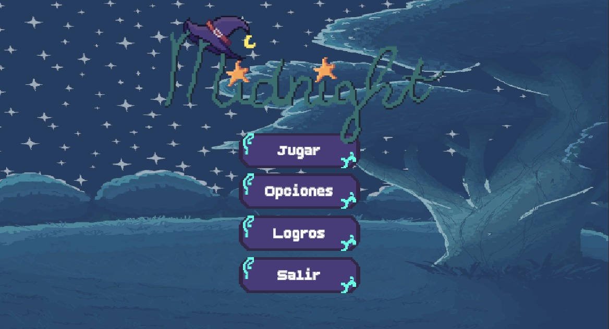
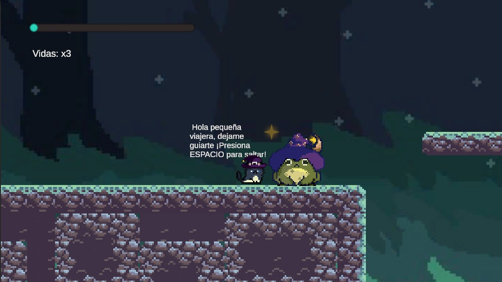
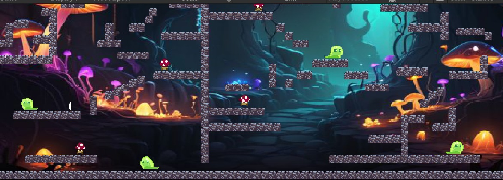
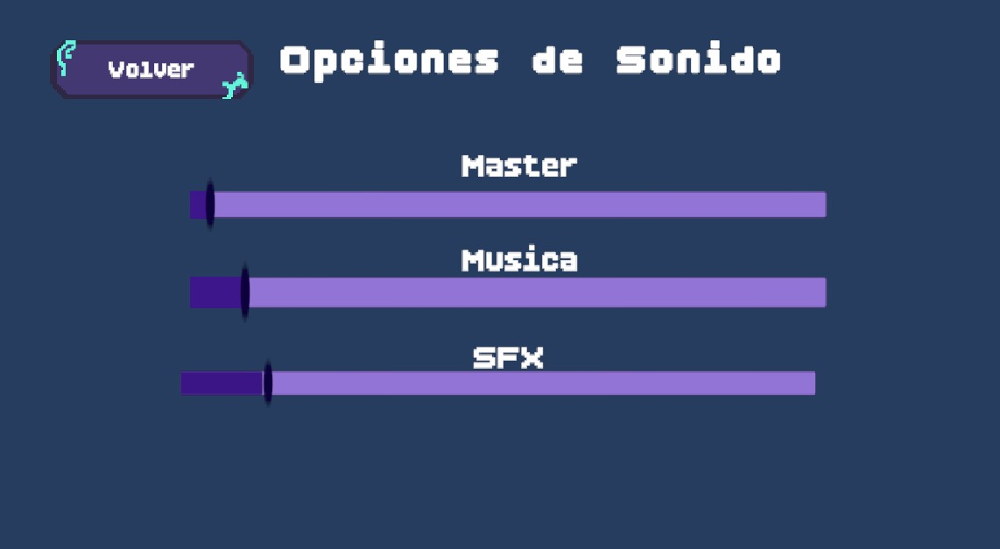
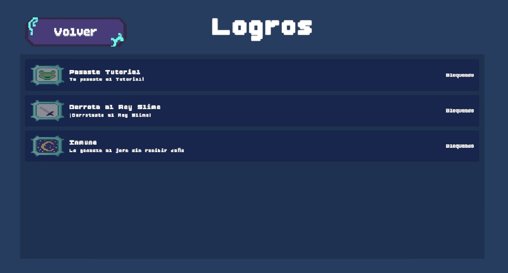
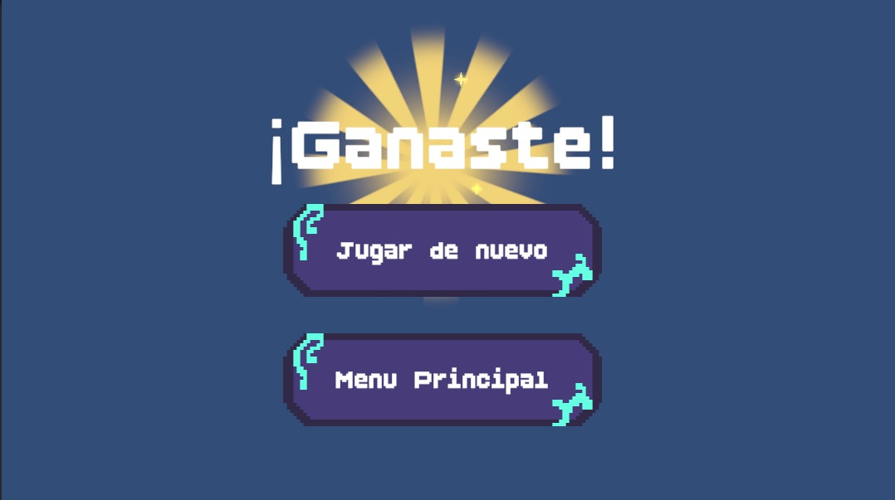

# ErmAcshuallyStudios · Midnight, plataformas 2D

**Trabajo Final Integrador** de *Programación de Videojuegos I* (TUDIVJ, Facultad de Ingeniería, UNJu)

**Estudio:** ErmAcshually Studios · **Repositorio:** [`ErmAcshuallyStudios_TFI_PVJ1`](https://github.com/kevinario21/ErmAcshuallyStudios_TFI_PVJ1)

**Versión de Unity:** _Unity 6.5 (6000.5.8f1)_ · **Pipeline:** URP 2D



## Desarrolladoras

| Nombre y Apellido | Usuario de GitHub | Rama |
|---|---|---|
| Gianella Gutierrez | _AlezzzGutierrez_ | `gianellaGutierrez` |
| Florencia Itati Quispe | _kevinario21_ | `QuispeFlorenciaItati` |
| Sara Barbara Miranda | _Miranda Sara_ | `MirandaSaraBarbara` |
| Estefani Mamaní | _Yohaneaaa_ | `EstefaniMamani` |
| Esmeralda González Tolay | _Lil_Esme_ | `Esmeralda-Gonzalez` |

## Descripción del juego

Plataformas 2D de desplazamiento lateral. **Midnight**, una gata, atraviesa un recorrido de niveles conectados entre sí, esquiva o elimina enemigos, junta monedas y llega hasta un jefe final. Al derrotarlo, la gata **recupera su forma humana**.

La partida se divide en cuatro escenas jugables:

1. **Tutorial:** una rana guía aparece al entrar en ciertas zonas y explica los controles con un globo de texto que se escribe letra por letra. Al terminar, el jugador pasa al primer nivel.
2. **Nivel 1:** nivel de plataformas con **hongos** que patrullan, **monedas** que suman puntaje y un **portal** que lleva al nivel siguiente. Incluye una división del mapa para elegir camino.
3. **Nivel 2 (subterráneo):** diseñado para aprovechar el sigilo. Hay **slimes** (con IA de estados) y **hongos** que patrullan. Termina en un punto de salida con trigger.
4. **Nivel 3 (superficie):** zona del **jefe final**. Al entrar en su arena se cierran las barreras, aparece la barra de vida del jefe y comienza el combate.

**Objetivo:** llegar al final de los niveles y vencer al jefe sin quedarte sin vidas.

**Peligros:** slimes que persiguen y atacan, hongos que dañan al contacto y proyectiles del jefe.

**Ayudas:** monedas, checkpoint de reaparición, ataque a distancia y logros desbloqueables.

### Flujo de escenas

```
Menú Principal ──► Tutorial ──► Nivel 1 ──► Nivel 2 ──► Nivel 3 ──► Victoria
      ▲                                                     │
      │                         Pausa (ESC) ◄───────────────┤
      └──────────── Derrota (sin vidas) ◄───────────────────┘
```

## Guía de controles

| Tecla | Acción |
|---|---|
| **A / D** o **← / →** | Mover a Midnight |
| **Espacio** | Saltar (solo si está apoyada en el suelo) |
| **J** | Disparar un proyectil (cooldown de 0,25 s) |
| **ESC** | Pausar y continuar |
| **Mouse** | Navegar menús, opciones y logros |

## Distribución de roles y ramas

Cada integrante trabajó en su propia rama y se integró a `main` mediante Pull Requests.

| Integrante | Rol | Scripts / recursos |
|---|---|---|
| Gianella Gutierrez | **Tutorial:** diseño del nivel y rana tutora con globos de texto | `Rana`, `ZonaTutorial`, `TipoTutorial` (enum), paleta de tilemaps, escena `Tutorial` |
| Florencia Itati Quispe | **Nivel 1:** físicas de Midnight, cámara, ataque a distancia, enemigos, monedas y puntaje | `PlayerMovement`, `PlayerStats`, `PlayerHealth`, `PlayerAnimation`, `CameraFollow`, `Shooting`, `Projectile`, `CoinPickup`, `ScoreDataSO`, `PortalNivel`, escena `Nivel1` |
| Sara Barbara Miranda | **Nivel 2 e IA enemiga:** nivel subterráneo, slimes con máquina de estados y hongos patrulleros | `SlimeAI`, `HongoPatrulla`, `EnemyHealth`, prefabs `Slime` y `Hongo`, escena `Nivel2` |
| Estefani Mamaní | **Nivel 3 y jefe:** superficie, jefe con patrones de disparo, arena y transformación a forma humana | `BossHealth`, `BossShooter`, `BossProjectile`, `BossArena`, `PlayerHumanForm`, prefab `BossFireball`, escena `Nivel3` |
| Esmeralda González Tolay | **Managers y UI:** menú principal, pausa, victoria/derrota, GameManager, AudioManager y logros | `GameManager`, `AudioManager`, `AchievementManager`, `GameEvents`, `MainMenuUI`, `PauseMenuUI`, `EndScreenUI`, `VolumeSettingsUI`, `AchievementListUI`, `AchievementNotificationUI`, `PlayerHealthUI`, `ScoreUI`, `ButtonSFX` |

## Detalle de los sistemas

### Jugador

- **Movimiento:** `Rigidbody2D` con velocidad horizontal y salto. El chequeo de suelo usa `Physics2D.OverlapCircle` filtrado por `LayerMask`.
- **Estadísticas** (`PlayerStats`, editables desde el Inspector): velocidad `8`, vida máxima `5` y `3` vidas. Al llegar a 0 de vida se pierde una vida y se reaparece en el último checkpoint con la vida completa. Sin vidas, se carga la escena de Derrota.
- **Disparo:** el proyectil sale del `firePoint` en la dirección en que mira el sprite, vuela 3 s como máximo y se destruye al chocar con suelo, pared o enemigo.
- **Forma humana:** al derrotar al jefe final, `PlayerHumanForm` cambia el sprite o el controlador de animación de la gata.

### Enemigos

| Enemigo | Comportamiento | Valores por defecto |
|---|---|---|
| **Slime** | Máquina de estados: *Patrulla → Persecución → Ataque*. Si el jugador está agachado, su rango de visión se reduce | Visión 6 (2 agachado), ataque a 1, cooldown 1,5 s, daño 1, velocidad 1,5 patrulla / 3 persecución |
| **Hongo** | Patrulla entre dos puntos y daña al contacto | Velocidad 1, daño 1, cooldown 1 s |
| **Jefe** | Dispara ráfagas por **arriba, abajo o alternado** (nunca repite el patrón anterior) con aviso en amarillo antes de disparar. Con la mitad de vida entra en **furia**: más disparos, más rápidos y con menos pausa | 10 de vida, 3 disparos por ráfaga, daño 1 |

Los enemigos genéricos usan `EnemyHealth` (3 de vida por defecto, con destello al recibir daño). El jefe usa `BossHealth` y avisa su muerte con `GameEvents.RaiseBossDefeated`.

### GameManager y estados

`GameManager` es un singleton persistente (`DontDestroyOnLoad`) con el enum:

```csharp
public enum GameState { Start, Playing, Paused, Victory, GameOver }
```

- El estado se deduce de la escena cargada (menú, nivel, victoria o derrota).
- La pausa congela el juego con `Time.timeScale = 0` y notifica a la UI y al audio mediante el evento `OnGameStateChanged`.
- Al derrotar al jefe, o al completar el tutorial, espera 3 s (para ver el logro) y carga el siguiente nivel o la pantalla de Victoria.

### Eventos (patrón Observador)

`GameEvents` es un bus estático de eventos compartido por todo el equipo: `OnTutorialCompleted`, `OnBossDefeated(string)`, `OnPlayerDamaged` y `OnPlayerDied`. Así, `GameManager`, `AchievementManager`, `AudioManager` y `PlayerHumanForm` reaccionan sin conocerse entre sí.

### Persistencia de datos

- **Puntaje:** `ScoreDataSO` (ScriptableObject) lo guarda en `PlayerPrefs` y lo conserva entre niveles. `ScoreUI` lo muestra en pantalla con TextMeshPro.
- **Volumen y logros:** también se guardan en `PlayerPrefs`.
- **Vida y vidas:** `PlayerStats` notifica cambios por eventos (`OnHealthChanged`, `OnLivesChanged`) que escucha `PlayerHealthUI`.

### Audio

`AudioManager` controla un `AudioMixer` con tres parámetros (`MasterVol`, `MusicVol`, `SFXVol`), ajustables con sliders desde el menú principal y desde la pausa. La música cambia según el estado del juego (menú, nivel, pausa, jefe, victoria, derrota). Hay efectos para salto, disparo, moneda, enemigo, power-up, disparo del jefe, botones y logros.

### Sistema de logros

Los logros son ScriptableObjects (`AchievementData`) en `Assets/Logros`, se desbloquean por evento y se muestran con un pop-up. Además, hay un panel con la lista en el menú principal.

| Logro | Condición |
|---|---|
| **Pasaste Tutorial** | Completar el tutorial |
| **Inmune** | Vencer al jefe sin recibir daño en ese nivel |
| **Derrota al Rey Slime** | Vencer al jefe del nivel 4 (`boss_nivel4`) |

### ScriptableObjects

| Archivo | Tipo | Qué parametriza |
|---|---|---|
| `ScoreData` | `ScoreDataSO` | Puntaje total, clave de guardado y autoguardado |
| `Tutorial`, `Inmune`, `BossNivel4` | `AchievementData` | Id, título, descripción, ícono, condición y jefe asociado |

## Capturas

### Menú principal


### Tutorial


### Nivel 1


### Nivel 2 · Subterráneo


### Nivel 3 · Jefe final


### Pausa y opciones de volumen


### Logros


### Victoria y Derrota



## Cómo abrir y ejecutar el proyecto

1. Clonar el repositorio:
   ```bash
   git clone https://github.com/kevinario21/ErmAcshuallyStudios_TFI_PVJ1
   ```
2. En **Unity Hub**: *Add > Add project from disk* y seleccionar la carpeta clonada.
3. Abrir el proyecto con **Unity 6000.5.8f1**.
4. Abrir la escena `MenuPrincipal` y presionar **Play**.

Las escenas deben estar en *File > Build Settings* en este orden: `MenuPrincipal`, `Tutorial`, `Nivel1`, `Nivel2`, `Nivel3`, `Victory`, `Defeat`.

## Flujo de trabajo en Git

- Repositorio público con `.gitignore` de Unity (se excluyen `Library/`, `Temp/`, `Logs/`, etc.).
- Una rama personal por integrante.
- Integración a `main` mediante **Pull Requests** y resolución de conflictos de merge.
- La evidencia del trabajo en paralelo se puede ver en *Insights > Network* del repositorio.

## Estructura del proyecto

```
Assets/
  Animations/        Controladores y clips de slime y hongo
  Audio/             Música, efectos y AudioMixer (MainMixer)
  BoldPixels/        Tipografía pixel
  BoldVFXPackDemo/   Efectos de partículas
  Images/            Fondos, botones, íconos y título
  Logros/            ScriptableObjects de logros
  Prefabs/           Player, Slime, Hongo, Projectile, BossFireball, Coin, managers y UI
  Scenes/            MenuPrincipal, Tutorial, Nivel1, Nivel2, Nivel3, Victory, Defeat
  ScriptableObjects/ ScoreData y ScoreDataSO
  Scripts/
    Enemy/           SlimeAI, HongoPatrulla, EnemyHealth, Boss*
    Managers/        GameManager, AudioManager, AchievementManager, PortalNivel
    Player/          Movimiento, estadísticas, disparo, cámara, monedas
    Tutorial/        Rana, ZonaTutorial
    Ui/              Menús, HUD, logros, GameEvents
  Settings/          Configuración de URP 2D e Input System
  Sprites/           Jugador, enemigos y fondos con tilemaps
ProjectSettings/
```

## Estado del proyecto y pendientes

- El **Nivel 4** (subterráneo) y el logro *Derrota al Rey Slime* están previstos, pero la escena no está incluida en el repositorio y figura deshabilitada en *Build Settings*.
- La rana del tutorial menciona agacharse, golpear, trepar y abrir el mapa, pero esas acciones todavía no tienen código de entrada. Hoy el ataque disponible es el disparo con **J**.
