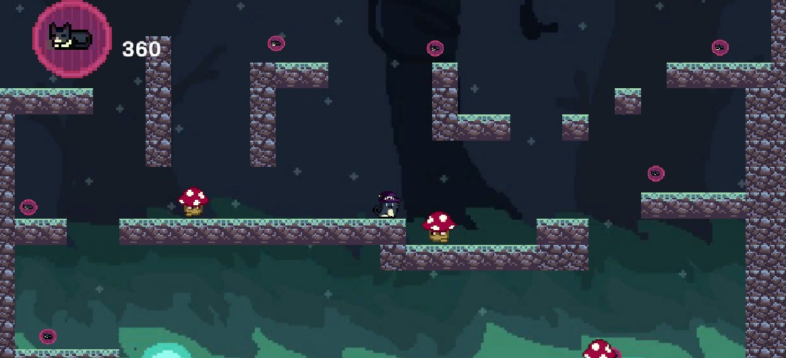
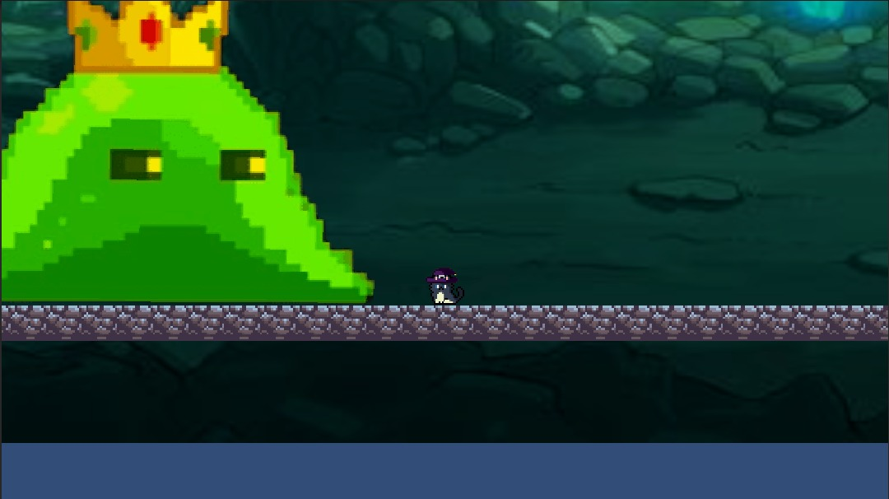
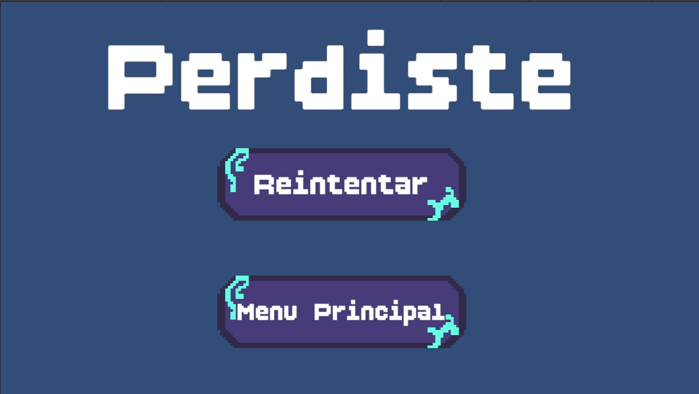

# ErmAcshuallyStudios · Midnight, plataformas 2D

**Trabajo Final Integrador** de *Programación de Videojuegos I* (TUDIVJ, Facultad de Ingeniería, UNJu)

**Estudio:** ErmAcshually Studios · **Repositorio:** [`ErmAcshuallyStudios_TFI_PVJ1`](https://github.com/kevinario21/ErmAcshuallyStudios_TFI_PVJ1)

**Versión de Unity:** _Unity 6.5 (6000.5.8f1)_ · **Pipeline:** URP 2D


## Desarrolladoras

| Nombre y Apellido | Usuario de GitHub | LU |
|---|---|---|
| Gianella Gutierrez | _AlezzzGutierrez_ | `TUV000800` |
| Florencia Itati Quispe | _kevinario21_ | `TUV000805` |
| Sara Barbara Miranda | _Miranda Sara_ | `TUV000749` |
| Estefani Mamaní | _Yohaneaaa_ | `TUV000820` |
| Esmeralda González Tolay | _Lil_Esme_ | `Tuv000821` |

## Descripción del juego

Plataformas 2D de desplazamiento lateral. **Midnight**, una gata, atraviesa un recorrido de niveles conectados entre sí, esquiva o elimina enemigos, junta monedas, escala paredes y llega hasta los jefes finales. Al derrotarlos, la gata **recupera su forma humana**.

La partida se divide en cuatro escenas jugables:

1. **Tutorial:** una rana guía aparece con efectos visuales al entrar en ciertas zonas y explica, con un globo de texto que se escribe letra por letra, cómo saltar, qué hacer ante los slimes, cómo golpear, cómo trepar y cómo se divide el mapa. Al llegar al final, el jugador pasa al primer nivel.
2. **Nivel 1:** nivel de plataformas con **hongos** que patrullan, **monedas** que suman puntaje y un **portal** que lleva al nivel siguiente. Incluye una división del mapa para elegir camino.
3. **Nivel 2 (subterráneo):** diseñado para aprovechar el sigilo. Hay **slimes** que corren hacia el jugador cuando lo detectan y **hongos** que patrullan. Un portal lleva al nivel final.
4. **Nivel 3 (superficie):** arenas de jefe. Al entrar en una arena se cierran las barreras, aparece la barra de vida del jefe y comienza el combate. Hay un **Guardián** y el **Rey Slime** (jefe final). La partida solo avanza cuando no queda ningún jefe vivo.

**Objetivo:** llegar al final de los niveles y vencer a los jefes sin quedarte sin vidas.

**Peligros:** slimes que persiguen y dañan al contacto, hongos que dañan al contacto, proyectiles y contacto con los jefes, y zonas de caída que devuelven al jugador al inicio.

**Ayudas:** monedas, checkpoint de reaparición, ataque a distancia, escalada y logros desbloqueables.

### Flujo de escenas

```
Menú Principal ──► Tutorial ──► Nivel 1 ──► Nivel 2 ──► Nivel 3 ──► Victoria
      ▲                                                     │
      │                         Pausa (ESC) ◄───────────────┤
      └──────────── Derrota (sin vidas) ◄───────────────────┘
```

## Guía de controles

| Tecla | Acción |
|---|---|
| **A / D** o **← / →** | Mover a Midnight |
| **Espacio** | Saltar (solo si está apoyada en el suelo; con una pausa breve entre saltos) |
| **W** o **↑** (junto a una pared) | Escalar. Dura hasta 1,5 s y se recupera al tocar el suelo |
| **J** | Disparar un proyectil (cooldown de 0,25 s) |
| **ESC** | Pausar y continuar |
| **Mouse** | Navegar menús, opciones y logros |

## Distribución de roles y ramas

Cada integrante trabajó en su propia rama. Además se usó una rama de integración, `Devmain`, que se fue incorporando a `main` mediante Pull Requests.

| Integrante | Rol | Scripts / recursos |
|---|---|---|
| Gianella Gutierrez | **Tutorial, jugador y HUD:** nivel tutorial con rana guía y VFX, escalada de paredes, HUD de vida y vidas, teletransporte al inicio y nueva lógica del slime | `Rana`, `RanaVFXController`, `ZonaTutorial`, `TeletransporteInicio`, `HUDVidaPlayer` (clase `PlayerHealthUI`), `SlimePerseguidor`, prefab `Teleport`, paleta de tilemaps, escena `Tutorial` |
| Florencia Itati Quispe | **Nivel 1:** físicas de Midnight, cámara, ataque a distancia, enemigos, monedas y puntaje | `PlayerMovement`, `PlayerStats`, `PlayerAnimation`, `CameraFollow`, `Shooting`, `Projectile`, `CoinPickup`, `ScoreDataSO`, `PortalNivel`, escena `Nivel1` |
| Sara Barbara Miranda | **Nivel 2 y enemigos:** nivel subterráneo, hongos patrulleros y slimes | `HongoPatrulla`, `EnemyHealth`, prefabs `Slime` y `Hongo`, escena `Nivel2` |
| Estefani Mamaní | **Nivel 3 y jefes:** superficie, jefes con patrones de disparo, arenas y transformación a forma humana | `BossHealth`, `BossShooter`, `BossProjectile`, `BossArena`, `PlayerHumanForm`, prefab `BossFireball`, escena `Nivel3` |
| Esmeralda González Tolay | **Managers y UI:** menú principal, pausa, victoria/derrota, GameManager, AudioManager y logros | `GameManager`, `AudioManager`, `AchievementManager`, `GameEvents`, `MainMenuUI`, `PauseMenuUI`, `EndScreenUI`, `VolumeSettingsUI`, `AchievementListUI`, `AchievementNotificationUI`, `ScoreUI`, `ButtonSFX` |

## Detalle de los sistemas

### Jugador

- **Movimiento:** `Rigidbody2D` con velocidad horizontal y salto. El chequeo de suelo usa `Physics2D.OverlapCircleAll` filtrado por `LayerMask` e ignora triggers y el propio collider.
- **Escalada:** un `wallCheck` detecta paredes en la dirección en que mira el sprite. Mientras se escala, la gravedad se anula y el movimiento vertical usa `climbSpeed`. El tiempo máximo (`maxClimbTime`) se reinicia al volver al suelo.
- **Estadísticas** (`PlayerStats`, editables desde el Inspector): velocidad `8`, vida máxima `5`, `3` vidas y `1 s` de invulnerabilidad tras recibir un golpe. Al llegar a 0 de vida se pierde una vida y se reaparece en el último checkpoint con la vida completa. Sin vidas, se carga la escena de Derrota.
- **Disparo:** el proyectil sale del `firePoint` en la dirección en que mira el sprite, vuela 3 s como máximo y se destruye al chocar con suelo, pared o enemigo.
- **Teletransporte al inicio:** `TeletransporteInicio` es un trigger que lleva al jugador a un punto de inicio y le anula la velocidad. Se usa como zona de caída.
- **Forma humana:** al derrotar a un jefe, `PlayerHumanForm` cambia el sprite o el controlador de animación de la gata.
- **HUD de vida:** `PlayerHealthUI` (archivo `HUDVidaPlayer.cs`) muestra una barra de vida, el texto `vida / máximo` y el contador de vidas, escuchando los eventos de `PlayerStats`.

### Enemigos

| Enemigo | Comportamiento | Valores por defecto |
|---|---|---|
| **Slime** (`SlimePerseguidor`) | Patrulla entre dos puntos (o espera quieto si no hay puntos). Si el jugador entra en su rango horizontal y a una altura cercana, **corre hacia él**. Daña al contacto | Detección 7, margen de altura 2,5, velocidad 1,5 patrulla / 4 al correr, daño 1, cooldown 1,2 s |
| **Hongo** | Patrulla entre dos puntos y daña al contacto. Se elimina con los proyectiles del jugador | Velocidad 1, daño 1, cooldown 1 s, 3 de vida |
| **Jefes** | Disparan ráfagas por **arriba, abajo o alternado** (nunca repiten el patrón anterior) con un aviso en amarillo antes de disparar. Con la mitad de vida entran en **furia**: más disparos, más rápidos y con menos pausa. Dañan también por contacto | Vida configurable desde el Inspector, ráfagas de 3 disparos (4 en el jefe final), daño 1 |

Los enemigos comunes usan `EnemyHealth` (3 de vida por defecto, con destello al recibir daño). Los jefes usan `BossHealth`, que avisa su muerte con `GameEvents.RaiseBossDefeated`.

| Jefe | Id | Tipo |
|---|---|---|
| Guardián | `boss_nivel3` | Intermedio |
| Rey Slime | `boss_nivel5` | Jefe final |

### GameManager y estados

`GameManager` es un singleton persistente (`DontDestroyOnLoad`) con el enum:

```csharp
public enum GameState { Start, Playing, Paused, Victory, GameOver }
```

- El estado se deduce de la escena cargada (menú, nivel, victoria o derrota).
- La pausa congela el juego con `Time.timeScale = 0` y notifica a la UI y al audio mediante el evento `OnGameStateChanged`.
- Al completar el tutorial o vencer a los jefes, espera 3 s (para ver el logro) y carga la escena siguiente. Si hay varios jefes en la escena, solo avanza cuando ya no queda ninguno vivo. Después del último nivel carga la pantalla de Victoria.
- Desde Derrota se puede reintentar el último nivel jugado.

### Eventos (patrón Observador)

`GameEvents` es un bus estático de eventos compartido por todo el equipo: `OnTutorialCompleted`, `OnBossDefeated(string)`, `OnPlayerDamaged`, `OnPlayerDamagedByBoss` y `OnPlayerDied`. Así, `GameManager`, `AchievementManager`, `AudioManager` y `PlayerHumanForm` reaccionan sin conocerse entre sí.

### Persistencia de datos

- **Puntaje:** `ScoreDataSO` (ScriptableObject) lo guarda en `PlayerPrefs` y lo conserva entre niveles. Se reinicia al empezar el Nivel 1.
- **Volumen y logros:** también se guardan en `PlayerPrefs`.
- **Vida y vidas:** `PlayerStats` notifica cambios por eventos (`OnHealthChanged`, `OnLivesChanged`) que escucha el HUD.

### Audio

`AudioManager` controla un `AudioMixer` con tres parámetros (`MasterVol`, `MusicVol`, `SFXVol`), ajustables con sliders desde el menú principal y desde la pausa. La música cambia según el estado del juego (menú, nivel, pausa, jefe, victoria, derrota). Hay efectos para salto, disparo, moneda, enemigo, power-up, disparo del jefe, botones y logros.

### Rana guía del tutorial

`Rana` se invoca desde cinco `ZonaTutorial` (cada una con su tema del enum `TipoTutorial`: saltar, slimes, golpear, trepar y mapa). Al aparecer reproduce tres efectos visuales: uno de aparición, uno en loop mientras está presente y uno de desaparición que sigue corriendo aunque la rana ya se haya ido. El mensaje se escribe letra por letra.

### Sistema de logros

Los logros son ScriptableObjects (`AchievementData`) en `Assets/Logros`, se desbloquean por evento y se muestran con un pop-up. Además, hay un panel con la lista en el menú principal.

| Logro | Condición |
|---|---|
| **Pasaste Tutorial** | Completar el tutorial |
| **Inmune** | Vencer a un jefe sin recibir daño en ese nivel |
| **Derrota al Rey Slime** | Vencer al Rey Slime |

### ScriptableObjects

| Archivo | Tipo | Qué parametriza |
|---|---|---|
| `ScoreData` | `ScoreDataSO` | Puntaje total, clave de guardado y autoguardado |
| `Tutorial`, `Inmune`, `BossNivel4` | `AchievementData` | Id, título, descripción, ícono, condición y jefe asociado |

## Capturas

### Menú principal


### Tutorial


### Nivel 1


### Nivel 2 · Subterráneo


### Nivel 3 · Jefes


### Pausa y opciones de volumen


### Logros


### Victoria y Derrota



## Cómo abrir y ejecutar el proyecto

1. Clonar el repositorio:
   ```bash
   git clone https://github.com/kevinario21/ErmAcshuallyStudios_TFI_PVJ1
   ```
2. En **Unity Hub**: *Add > Add project from disk* y seleccionar la carpeta clonada.
3. Abrir el proyecto con **Unity 6000.5.8f1**.
4. Abrir la escena `MenuPrincipal` y presionar **Play**.

Las escenas deben estar en *File > Build Settings* en este orden: `MenuPrincipal`, `Tutorial`, `Nivel1`, `Nivel2`, `Nivel3`, `Victory`, `Defeat`.

## Flujo de trabajo en Git

- Repositorio público con `.gitignore` de Unity (se excluyen `Library/`, `Temp/`, `Logs/`, etc.).
- Una rama personal por integrante, más una rama de integración (`Devmain`).
- Más de 100 commits descriptivos y integración a `main` mediante **Pull Requests**, con resolución de conflictos de merge.
- La evidencia del trabajo en paralelo se puede ver en *Insights > Network* del repositorio.

## Estructura del proyecto

```
Assets/
  Animations/        Controladores y clips de slime y hongo
  Audio/             Música, efectos y AudioMixer (MainMixer)
  BoldPixels/        Tipografía pixel
  BoldVFXPackDemo/   Efectos de partículas
  Images/            Fondos, botones, íconos y título
  Logros/            ScriptableObjects de logros
  Prefabs/           Player, Slime, Hongo, Projectile, BossFireball, Coin, Teleport, managers y UI
  Scenes/            MenuPrincipal, Tutorial, Nivel1, Nivel2, Nivel3, Victory, Defeat
  ScriptableObjects/ ScoreData y ScoreDataSO
  Scripts/
    Enemy/           SlimePerseguidor, HongoPatrulla, EnemyHealth, Boss*
    Managers/        GameManager, AudioManager, AchievementManager, PortalNivel
    Player/          Movimiento, estadísticas, disparo, cámara, monedas, HUD de vida, teletransporte
    Tutorial/        Rana, RanaVFXController, ZonaTutorial
    Ui/              Menús, logros, GameEvents
  Settings/          Configuración de URP 2D e Input System
  Sprites/           Jugador, enemigos y fondos
  Tiles/             Prefabs y tiles de suelo
ProjectSettings/
Screenshots/         Capturas usadas en este README
```
